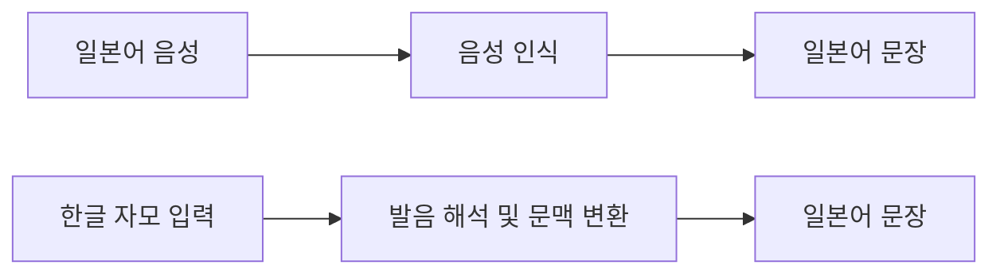
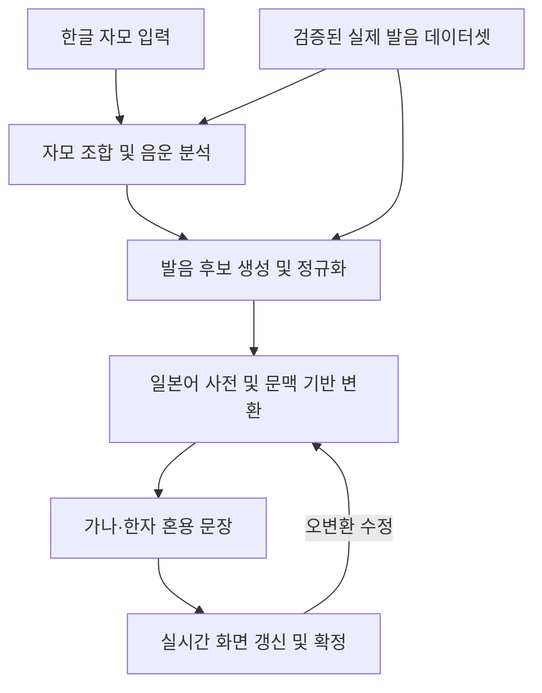

# HanBoard · 한보드

**A BeFRee Project initiative · BeFRee Project 산하 연구·개발 프로젝트**

*One Alphabet. Many Languages.*

**Type as you speak.**  
**말하듯이 입력하다.**

> 자국의 문자 체계를 일반적인 키보드로 직접 입력하기 어려워 로마자 기반 입력기에 의존하거나 이를 대안으로 사용하는 사람들이, 한글의 자음·모음 조합 원리를 활용하면 자신의 언어를 더 쉽고 편리하게 입력할 수 있을까?

HanBoard는 이 질문에서 출발한 **한글 기반 다국어 발음 입력 시스템 연구 및 개발 프로젝트**입니다. 첫 번째 제품인 **HanBoard Tokyo**는 일본어 원어민이 한글 자판으로 일본어 발음을 입력하면, 시스템이 문맥에 맞는 자연스러운 일본어 문장을 출력하는 키보드를 목표로 합니다.

HanBoard is a multilingual phonetic input research project built around the consonant–vowel composition principles of Hangul. It focuses on non-Latin writing systems where native-script entry is complex and romanized phonetic input is used as an alternative. Its first planned keyboard, HanBoard Tokyo, is designed for native Japanese speakers, not for translation or Korean language learning. Latin-script languages are outside the current scope.

[City Series 디자인 방향 및 브랜드 자산](assets/README.md) · 최종 콘셉트 이미지 등록 예정

*현재 개발 대상은 Tokyo이며, 나머지 도시는 향후 확장 후보입니다.*

**프로젝트 상태:** iOS 프로토타입 시뮬레이터 빌드 완료 · 실기기 설치 및 검증 진행 중 · 실제 관측 데이터셋 구축 전

**대상 플랫폼:** iOS 우선 검토  
**프로젝트 유형:** BeFRee Project의 독립 연구·개발 프로젝트 · 공개 설계 문서 운영 중 · 코드·데이터 라이선스 미확정

---

## 목차

- [1. 프로젝트를 시작한 이유](#1-프로젝트를-시작한-이유)
- [2. 무엇이 다른가](#2-무엇이-다른가)
- [3. HanBoard City Series](#3-hanboard-city-series)
- [4. HanBoard Tokyo의 사용자 경험](#4-hanboard-tokyo의-사용자-경험)
- [5. 한글 자판 설계](#5-한글-자판-설계)
- [6. 일본어 발음 매핑](#6-일본어-발음-매핑)
- [7. 입력 및 변환 엔진](#7-입력-및-변환-엔진)
- [8. 실제 발음 표기 데이터셋](#8-실제-발음-표기-데이터셋)
- [9. 연구 가설 및 성능 평가](#9-연구-가설-및-성능-평가)
- [10. 기술 구현 방향](#10-기술-구현-방향)
- [11. 저장소 구성](#11-저장소-구성)
- [12. 개발 로드맵](#12-개발-로드맵)
- [13. 기여 방법 및 연구 윤리](#13-기여-방법-및-연구-윤리)
- [14. 참고 자료](#14-참고-자료)
- [15. 라이선스와 프로젝트 상태](#15-라이선스와-프로젝트-상태)

## 1. 프로젝트를 시작한 이유

한글은 자음과 모음을 조합해 소리를 표현하는 문자입니다. 두벌식 자판에서는 자음과 모음이 좌우에 나뉘어 있고, `ㅑ`, `ㅠ`, `ㅛ`와 같이 여러 발음 조합을 간결하게 입력할 수 있습니다. 이러한 구조가 한국어 이외의 언어를 입력할 때에도 장점이 있을 수 있다는 것이 HanBoard의 출발점입니다.

일본어는 기본적으로 자음과 모음의 조합이 많고, 요음·비음·촉음·장음 등도 일정한 규칙을 통해 표현할 수 있습니다. 기존에는 PC에서 로마자 입력, 스마트폰에서는 로마자 입력이나 12키 플릭 입력 등 다양한 방식을 사용합니다. HanBoard는 이들과 경쟁할 수 있는 새로운 입력 방식을 연구합니다.

**중요한 전제는 한글 자판이 반드시 더 빠르거나 쉽다는 결론을 미리 내리지 않는다는 것입니다.** 일본인에게 한글 자모는 익숙하지 않은 기호일 수 있으며, 이미 숙련된 플릭 입력을 대체하기 어려울 수도 있습니다. 실제 입력 시간, 정확도, 학습 비용까지 검증해야 합니다.

첫 번째 연구 대상은 일본어입니다. 향후 확장 대상은 자국 문자의 종류나 조합이 많아 일반적인 제한된 키 배열로 입력하기 어렵고, 로마자를 발음 입력의 매개로 사용하는 비라틴 문자 언어권으로 한정합니다. 영어·프랑스어·베트남어 등 라틴 문자 기반 언어는 현재 범위에서 제외합니다. 각 언어의 음운 구조와 실제 입력 관행을 조사한 뒤 확장 타당성을 검증합니다.

## 2. 무엇이 다른가

HanBoard는 한국인을 위한 일본어 학습 앱이나 한국어→일본어 번역 앱을 만드는 프로젝트가 아닙니다. 일본어 원어민이 자신의 언어를 입력하는 새로운 IME(Input Method Editor, 입력기)를 만드는 프로젝트입니다.

| 구분 | 일반적인 발음 변환·번역 앱 | HanBoard Tokyo |
| --- | --- | --- |
| 핵심 사용자 | 외국어를 입력하거나 배우려는 사용자 | 일본어 원어민 |
| 목적 | 외국어 입력 보조, 학습 또는 번역 | 모국어 입력 편의와 효율 향상 |
| 한글의 역할 | 한국어 또는 발음 표기 | 자음·모음 중심의 입력 인터페이스 |
| 입력 결과 | 가나, 번역문 등 앱마다 다름 | 사용자가 표현한 일본어 문장 |
| 한자 변환 | 앱별 자동 변환 또는 후보 선택 | 문맥 기반 실시간 자동 변환 중심 |
| 번역 기능 | 제품에 따라 제공 | 개발 범위에서 제외 |

HanBoard의 개념은 **일본어 음성 받아쓰기(Speech-to-Text)의 키보드 버전**으로 설명할 수 있습니다.



음성 대신 손가락으로 발음을 입력할 뿐, 최종 결과는 자신의 언어로 완성된 문장입니다. 다만 음성 인식은 실제 소리의 길이와 음향 정보도 활용하는 반면, 키보드는 입력되지 않은 발음 정보를 직접 알 수 없습니다. 따라서 장음과 촉음 등 의미를 바꾸는 구별은 입력 체계에서 보존하고, 문맥 분석으로 보완해야 합니다.

## 3. HanBoard City Series

HanBoard는 여러 언어를 하나의 공통 브랜드 아래 독립적인 키보드 시리즈로 제공하는 것을 목표로 합니다. 도시의 이름을 사용해 각 앱의 개성과 시리즈의 통일성을 표현합니다.

### 대상 언어 선정 기준

- 비라틴 문자 체계를 사용하며, 문자 종류 또는 결합 방식 때문에 제한된 키보드에서 직접 입력하기 어려운 언어
- 로마자 기반 발음 입력기가 실제로 사용되는 언어
- 한글 자모의 조합 원리가 기존 입력 방식보다 편리할 가능성이 있는 언어

라틴 문자를 본래 표기 문자로 사용하는 언어는 현재 대상에서 제외합니다. 단순히 문자 수가 키 수보다 많다는 이유만으로 개발을 결정하지 않고, 기존 입력 방식의 편의성 및 한글 기반 입력의 개선 가능성을 검증합니다.

| 제품명 | 대상 언어 | 기존 입력 방식 (예시) | 개발 상태 |
| --- | --- | --- | --- |
| **HanBoard Tokyo** | 일본어 · 日本語 | 로마자 입력, 가나·플릭 입력 | 첫 번째 연구 및 개발 대상 |
| HanBoard Beijing | 표준 중국어 · 普通话 | 병음(Pinyin) 기반 입력 | 확장 연구 후보 |
| HanBoard Bangkok | 태국어 · ภาษาไทย | 태국어 자판, 로마자 기반 변환 입력 | 확장 연구 후보 |
| HanBoard Delhi | 힌디어 · हिन्दी | 로마자 → 데바나가리 문자 변환 | 확장 연구 후보 |
| HanBoard Dhaka | 벵골어 · বাংলা | Avro 등 로마자 기반 발음 입력 | 확장 연구 후보 |
| HanBoard Chennai | 타밀어 · தமிழ் | 로마자 기반 발음 입력 | 확장 연구 후보 |

도시 이름은 브랜드 명명 방식이며 해당 도시 또는 국가의 모든 언어를 지원한다는 의미는 아닙니다. 실제 지원 언어·방언·지역은 앱 설명에서 명확히 안내합니다. 일본어 이외의 언어는 개발이 확정된 것이 아니며, 특히 태국어 등 자국 문자 직접 입력이 일반적인 언어는 로마자 입력의 실제 사용성과 수요를 별도로 검증해야 합니다. 중국어와 태국어의 성조, 인도계 문자의 모음 결합 및 자음군 등 각 언어의 특성도 개별 연구 대상으로 삼습니다.

### 디자인 아이덴티티

- 공통 심볼은 흰색 한글 자모 **`ㅎ`**입니다.
- 상단에는 도시의 상징적인 풍경을 배경으로 사용하고, 도시별 색감과 분위기를 표현합니다.
- 하단 크림색 영역에는 **도시 이름만** 표시합니다. `HANBOARD` 문구는 아이콘 안에 중복 표기하지 않습니다.
- 국기나 추가 키캡은 기본 시안에서 제외합니다.
- 실제 홈 화면에서 심볼과 도시명이 충분히 식별되는지 검증한 뒤 최종 아이콘을 제작합니다.

최종 선택한 시리즈 디자인은 Tokyo, Beijing, Bangkok, Delhi, Dhaka, Chennai의 6개 도시 콘셉트입니다. 원본 이미지의 저장소 등록은 아직 남아 있습니다. 정식 앱 아이콘 규격 및 상표 사용 가능성은 출시 전에 확인해야 합니다.

## 4. HanBoard Tokyo의 사용자 경험

사용자는 자신의 일본어 발음을 떠올리며 한글 자모를 누릅니다. 한글은 내부 입력 수단이고, 실제 입력창에는 일본어가 표시됩니다.

예를 들어 다음과 같은 사용 경험을 목표로 합니다.

| 사용자가 입력하려는 발음 | 최종 일본어 출력 예시 |
| --- | --- |
| 스시 | 寿司 |
| 다이죠부 | 大丈夫 |
| 춋토 맛테 | ちょっと待って |
| 스미마센 | すみません |
| 아리가토오 | ありがとう |
| 코레와 난데스카 | これは何ですか？ |

*예시는 목표 동작을 설명하기 위한 것으로, 구현 결과나 실제 관측 데이터가 아닙니다. 모든 유사 한글 발음이 항상 유일한 일본어 문장을 결정하는 것은 아닙니다.*

### 사용 경험 원칙

1. 발음에 해당하는 자모를 터치합니다. 기본 입력에는 플릭(밀기) 동작을 요구하지 않습니다.
2. 자모 조합 및 발음 해석을 내부에서 수행합니다.
3. 문맥에 맞춰 가나·한자를 선택하고 실제 입력창에 자동으로 반영합니다.
4. 이후 입력이 추가되면 아직 확정되지 않은 텍스트를 문맥에 맞게 갱신합니다.
5. 자동 변환 결과가 잘못된 경우에만 수정·재변환 기능을 사용합니다.

기존 일본어 입력기처럼 여러 한자 후보를 매번 나열하고 선택하게 하는 경험을 기본 흐름으로 두지 않습니다. 다만 동음이의어, 인명·지명, 고유명사 등은 문맥만으로 결정할 수 없는 경우가 있으므로 정확한 표기를 지정할 수 있는 보조 수단을 마련해야 합니다. 변환 엔진은 표현을 임의로 바꾸는 번역기나 문장 재작성기가 아니라, 사용자의 발음과 의도를 보존하는 입력기여야 합니다.

## 5. 한글 자판 설계

### 5.1 기본 설계 원칙

- 기존 한글 두벌식 자판의 자모 위치와 구조를 최대한 유지합니다.
- 자음과 모음의 좌우 분리 원칙을 존중합니다.
- `ㅜ`와 `ㅡ`, `ㅐ`와 `ㅔ`를 모두 유지하고 각각 같은 일본어 모음 계열로 입력할 수 있도록 합니다.
- `ㅘ`처럼 기본 키의 조합으로 만들 수 있는 복합 모음을 독립 키로 추가하지 않습니다.
- Shift 키는 가타카나 입력 모드 전환에 활용하는 방향으로 설계합니다. 기존 자모 조합과 받침으로 특수음을 처리하는 규칙을 연구합니다.
- 쉼표와 마침표 전용 키를 기본 자판에 별도로 배치하지 않습니다. 특수문자 모드 및 문맥 기반 문장부호 보정을 사용합니다.
- 스페이스·삭제·줄바꿈·숫자 및 특수문자 전환 등 기본 기능을 유지합니다. iOS 시스템 전환 키는 플랫폼 요구에 따라 별도 구현합니다.
- 일본어 가나 키를 기본 자판에 추가하지 않는 방향을 우선합니다.

### 5.2 기본 자판 — 기존 두벌식 100% 유지

HanBoard Tokyo의 기본 자판은 현대 한글 두벌식의 26개 자모 위치를 그대로 사용합니다. 옛한글을 추가하지 않으며, 일본어에 직접 대응하지 않는 `ㅓ`와 `ㅕ`도 원래 위치에 유지합니다.

```text
 ㅂ  ㅈ  ㄷ  ㄱ  ㅅ  ㅛ  ㅕ  ㅑ  ㅐ  ㅔ
   ㅁ  ㄴ  ㅇ  ㄹ  ㅎ  ㅗ  ㅓ  ㅏ  ㅣ
⇧    ㅋ  ㅌ  ㅊ  ㅍ  ㅠ  ㅜ  ㅡ    ⌫
[123]          [space]             [↵]
```

- 기존 자모 위치 유지율: **26/26 (100%)**
- Shift: 가타카나 입력 모드 전환 (초기 설계)
- 비음 `ん`: 현대 한글 받침을 활용하는 문맥 규칙 연구
- 촉음 `っ`: 받침과 자음 반복 등 기존 자모 조합을 활용하는 규칙 연구
- `ㅓ`·`ㅕ`: 키는 유지하되 v0.1 기본 매핑은 미정

옛이응 등 추가 자모를 도입했던 초기 연구안은 기본 자판에서 제외합니다. 배열은 유지하되 세부 발음 변환 규칙은 데이터 및 사용성 연구를 통해 검증합니다.

### 5.3 모바일 입력 방식

기본안은 기존 두벌식 기반의 터치 자판입니다. 스마트폰에서 한 손으로 입력하는 사용자도 고려하여 LG 나랏글의 가획 원리를 응용한 12키 터치 방식도 별도의 실험 후보로 둘 수 있습니다. 플릭 입력은 기본 UX로 채택하지 않지만 성능 비교 대상으로 반드시 포함합니다. 터치 횟수와 플릭 동작 횟수는 서로 다른 물리적 동작이므로 단순한 횟수 비교로 속도를 판단하지 않습니다.

## 6. 일본어 발음 매핑

### 6.1 매핑의 기준

HanBoard의 목표는 한국어 외래어 표기 규범을 구현하는 것이 아닙니다. **한국인이 일본어를 듣고 실제로 어떻게 한글로 적는지**를 관찰하고, 그 자료에서 발음 대응 규칙을 도출합니다. 동시에 일본어 원어민용 입력기에서는 의미를 구별하는 일본어 음운의 차이를 가능한 한 보존해야 합니다.

예를 들어 `ちょっと`를 듣고 `춋또`, `춋토`, `죳토`, `죠또` 등으로 적을 수 있습니다. 이처럼 비공식 표기의 다양성은 자료에서 확인해야 할 연구 대상입니다. 입력기의 기본 규칙과 유사 발음 허용 규칙을 분리하여, 사용자의 입력을 무조건 하나의 발음으로 합치지 않도록 합니다.

### 6.2 기본 모음 매핑안

| 한글 입력 | 일본어 발음 계열 | 설계 방향 |
| --- | --- | --- |
| ㅏ | あ (a) | 유지 |
| ㅣ | い (i) | 유지 |
| ㅜ / ㅡ | う (u) | 둘 다 허용. 예: `ㅅㅡ`, `ㅅㅜ` → す |
| ㅐ / ㅔ | え (e) | 둘 다 허용 |
| ㅗ | お (o) | 유지 |
| ㅑ | や / ゃ (ya) | 단독 및 자음 조합 |
| ㅠ | ゆ / ゅ (yu) | 단독 및 자음 조합 |
| ㅛ | よ / ょ (yo) | 단독 및 자음 조합 |
| ㅓ / ㅕ | 표준 일본어에 직접 대응하는 별도 모음 없음 | 기존 키 유지, 기본 매핑은 미정 |

`ㅇㅣ`와 같이 초성 `ㅇ`을 입력하는 방식과 모음 단독으로 `ㅣ`를 입력하는 방식은 둘 다 연구 대상입니다. 기본 모음의 단타 입력은 타수를 줄일 가능성이 있지만, 기존 한글 음절 조합이나 연속 모음 처리와 충돌할 수 있습니다. 기본 입력 규칙을 정의하기 전 두 방식의 장단점을 비교합니다.

### 6.3 기본 자음 매핑안

다음은 입력 엔진의 출발점이 되는 잠정적인 대응 관계입니다. 실제 한국인의 표기 관찰 및 일본어 음소 구별 실험에 따라 수정될 수 있습니다.

| 한글 자음 | 일본어 발음 계열 | 가나 예시 |
| --- | --- | --- |
| ㅋ | k | か・き・く・け・こ |
| ㄱ | g | が・ぎ・ぐ・げ・ご |
| ㅅ | s/sh | さ・し・す・せ・そ |
| ㅈ | z/j | ざ・じ・ず・ぜ・ぞ |
| ㅌ | t | た・て・と |
| ㅊ | ch/ts | ち・つ・ちゃ・ちゅ・ちょ |
| ㄷ | d | だ・で・ど |
| ㄴ | n | な・に・ぬ・ね・の |
| ㅎ | h/f | は・ひ・ふ・へ・ほ |
| ㅂ | b | ば・び・ぶ・べ・ぼ |
| ㅍ | p | ぱ・ぴ・ぷ・ぺ・ぽ |
| ㅁ | m | ま・み・む・め・も |
| ㄹ | r | ら・り・る・れ・ろ |
| ㅇ | 모음 시작 또는 종성 등 | 역할 및 확장 규칙 검증 필요 |

옛한글 반치음 `ㅿ`은 기본 자판에 도입하지 않고 `ㅈ`으로 Z/J 계열을 처리합니다. 순경음 피읖 `ㆄ` 역시 기본 자판에 넣지 않습니다. 외래음 `ファ`, `ヴァ`, `ティ` 등의 별도 입력 방법과 `ぢ`/`づ` 같은 표기 지정은 후속 규칙 연구에서 해결합니다.

기계 판독용 초기 매핑표: [mappings/ja/kana.csv](mappings/ja/kana.csv). 기본 규칙과 유사 입력 및 외래음 가안을 구분해 관리합니다.

### 6.4 특수음과 조합

| 대상 | 후보 입력 규칙 | 현재 상태 |
| --- | --- | --- |
| 비음 `ん` | 모음 뒤에서 받침으로 해석되는 `ㄴ`을 기본 후보로 사용하고 `ㅁ`·`ㅇ`은 유사 입력 후보로 연구 | 문맥 조건 검증 필요 |
| 촉음 `っ` | 종성 `ㅅ` 또는 `ㅈ`, 쌍자음, 자음 반복 등 | 비교 검증 |
| 요음 `ゃ・ゅ・ょ` | 자음 + `ㅑ・ㅠ・ㅛ` | 기본 방향 |
| 장음 | 모음을 반복 입력하고 표기는 문맥에서 결정 | 기본 방향, 단장음 보존 필수 |
| `わ` | `ㅗ+ㅏ` 등 기본 자모 조합 | `おあ`와의 충돌 처리 필요 |
| 조사 `は・へ・を` | 실제 발음 `わ・え・お`로 입력 | 문맥 보정 필요 |
| 문장부호 | 특수문자 모드 또는 자동 삽입 | 자동 처리 on/off 검토 |

한국식 비공식 표기에서 `아리가또`처럼 촉음이 없는 단어에도 쌍자음이 사용될 수 있습니다. 따라서 쌍자음을 모두 `っ`으로 변환하는 것은 안전한 규칙이 아닙니다. 마찬가지로 `죠`와 `쵸`, `고`와 `코`를 무조건 합치면 일본어 원어민에게 중요한 발음 구별을 잃을 수 있습니다. 여러 입력 후보의 우선순위와 문맥 처리가 필요한 이유입니다.

아래아 `ㆍ`는 장음이나 마침표를 위한 기본 키로 채택하지 않고 보류합니다. 장음 표기 자체는 문맥에서 추론할 수 있지만, 장단음 정보 자체를 생략하면 `おばさん`과 `おばあさん`처럼 의미가 다른 단어가 모호해질 수 있습니다.

## 7. 입력 및 변환 엔진



엔진은 역할별로 나눕니다.

| 구성 | 역할 |
| --- | --- |
| Jamo Input | 터치, Shift, 삭제, 자모 입력 상태 관리 |
| Phonetic Mapper | 자모에서 일본어 발음 단위 또는 가나 후보 생성 |
| Phonetic Normalizer | 유사 발음 입력, 장음, 촉음, 비음의 후보 처리 |
| Japanese Context Engine | 형태소 및 문맥 분석, 가나·한자·조사 표기 결정 |
| Composition Manager | 입력 중 텍스트 갱신, 확정, 커서 및 삭제 처리 |
| Evaluation | 매핑 충돌, 발음 보존, 변환 정확도, 입력 효율 검증 |

규칙으로 명확하게 처리할 수 있는 자모 조합은 가능한 한 결정적인 규칙 엔진으로 구현합니다. 모호한 발음 표기와 한자 선택 등 문맥이 필요한 영역에서 사전과 언어 모델을 활용합니다.

자연스러운 일본어 결과를 얻기 위해 AI가 사용자의 문장을 창작하거나 고쳐 쓰는 것은 목표가 아닙니다. 후보가 발음과 일치하는지 검사하고, 입력 내용이 누락되거나 의미가 바뀌지 않도록 해야 합니다.

## 8. 실제 발음 표기 데이터셋

### 8.1 연구 목적

국립국어원의 공식 외래어 표기 규칙은 참고 자료 중 하나입니다. 그러나 실제 사용자가 듣고 적는 발음과 규범적 표기는 다를 수 있습니다. HanBoard는 **한국인의 비공식 일본어 한글 발음 표기 자료를 체계적으로 구축**하는 별도 공개 연구를 계획합니다.

이 데이터셋으로 다음 질문을 분석할 수 있습니다.

- 일본어 `ちょっと`에 대응하는 한글 표기에는 어떤 변이가 있는가?
- 일본어 무성음과 유성음은 실제 한글에서 어떻게 구별되는가?
- 촉음은 받침, 쌍자음, 자음 반복 중 어떤 방식으로 표기되는가?
- `ん`을 표기할 때 뒤따르는 소리에 따라 받침이 달라지는가?
- 장음은 모음 반복, 생략 등 어떤 방식으로 표현되는가?
- 실제 한글 입력 패턴을 바탕으로 일본어 원어민용 기본 매핑과 보조 매핑을 어떻게 설계할 수 있는가?

한국인 학습자의 표기 분포와 일본어 원어민의 키보드 선호는 별개의 자료입니다. 전자는 자모 매핑의 참고 근거이고, 후자는 일본인 대상 사용성 실험으로 따로 검증합니다.

### 8.2 데이터 종류

| 종류 | 설명 | 사용 원칙 |
| --- | --- | --- |
| Observed | 실제 블로그·게시글·회화 자료·자발적 사용 사례 | 출처 및 실제 사용 여부 검증 |
| Elicited | 연구 참여자가 제시된 발음을 듣고 직접 작성한 표기 | 동의 및 실험 조건 기록 |
| Synthetic | 규칙이나 AI가 만들어 낸 발음 변형 | 별도 저장, 실제 사용 빈도 산정에서 제외 |

검증 여부는 데이터 종류와 별도의 상태 값으로 관리합니다. 예를 들어 실제 관측 자료도 원문 대응이 확인되지 않았다면 미검증 상태일 수 있습니다. 인위적으로 생성한 데이터는 정확한 변환이 확인되더라도 실제 관측 자료로 바뀌지 않습니다.

### 8.3 데이터 구조 예시

하나의 일본어 원문에 여러 한글 표기가 대응할 수 있도록 **한 표기 사례를 한 행으로 기록**합니다. 원본 발음 표기를 보존하고, 정규화 및 자모 분리 결과는 별도 필드로 저장합니다.

| japanese | kana | hangul_raw | data_type | verification_status |
| --- | --- | --- | --- | --- |
| ちょっと | ちょっと | 춋또 | example | unverified |
| ちょっと | ちょっと | 죳토 | example | unverified |
| ちょっと | ちょっと | 죠또 | example | unverified |
| ありがとう | ありがとう | 아리가또 | example | unverified |
| ありがとう | ありがとう | 아리가토오 | example | unverified |
| 寿司 | すし | 스시 | example | unverified |
| 大丈夫 | だいじょうぶ | 다이죠부 | example | unverified |

*이 표는 스키마 설명용 예시입니다. 아직 출처별 검증이 완료되지 않았으며, 관측 데이터의 수량이나 빈도로 계산하지 않습니다.*

권장 데이터 필드:

| 필드 | 내용 |
| --- | --- |
| `record_id` | 고유 사례 식별자 |
| `japanese` | 일본어 원문 또는 확인된 대응 표기 |
| `kana` | 일본어 가나 읽기 |
| `phonetic_reading` | 필요할 경우 실제 발음 기반 별도 읽기 |
| `hangul_raw` | 실제 관측 또는 제출된 원래 한글 표기 |
| `hangul_normalized` | 분석용 정규화 표기 |
| `jamo` | 초성·중성·종성 분해 결과 |
| `romaji` | 비교 실험에 사용할 로마자 입력 |
| `source_id`, `source_url` | 출처 추적 정보 |
| `source_type` | 블로그, 회화 자료, 직접 기여 등 |
| `observed_at`, `collected_at` | 관측 및 수집 시점 |
| `data_type` | observed, elicited, synthetic, example |
| `verification_status` | unverified, verified, rejected 등 |
| `rights_status`, `license` | 재배포 가능 여부 및 라이선스 |
| `phenomena` | 촉음, 장음, 비음, 요음, 탁음 등 분석 태그 |
| `notes` | 모호성, 다중 후보, 검증 관련 메모 |

### 8.4 수집 및 검증 절차

1. 사용 사례 또는 기여 데이터를 발견합니다.
2. 출처와 수집 허용 조건을 확인합니다. 사이트 접근 및 대량 수집 제한을 준수합니다.
3. 원래 한글 표기와 실제 일본어 원문을 연결합니다. 문맥만으로 추정한 사례는 구분합니다.
4. 개인정보를 제거하고 공개 가능한 최소 데이터만 저장합니다.
5. 원본을 보존한 상태에서 Unicode 정규화와 자모 분리를 수행합니다.
6. 동일 출처의 복제 사례를 식별하고 일본어 읽기와 대응 관계를 검토합니다.
7. 재배포 권리를 확보한 자료만 공개 데이터 릴리스에 포함합니다.
8. 분석 결과를 발음별 매핑 규칙과 검증 테스트에 반영합니다.

단순히 인터넷에 공개되어 있다는 이유로 타인의 글 전체나 데이터베이스를 복제하지 않습니다. 실제 빈도를 분석할 때는 검색 노출 편향, 동일 게시글의 재게시, 특정 여행 표현이나 학습 자료에 집중되는 편향을 고려합니다. 원문 전체 수집 대신 필요한 최소 사례 및 허용된 출처 정보를 활용합니다.

### 8.5 데이터셋 버전 목표 (잠정)

| 버전 | 목표 관측·참여자 데이터 | 주요 목적 |
| --- | ---: | --- |
| v0.1 | 1,000건 | 데이터 스키마와 발음 매핑 검증 |
| v0.2 | 10,000건 | 다양한 발음 패턴과 변이 분석 |
| v0.3 | 50,000건 | 구절·문장 단위 변환 및 오류 분석 |
| v1.0 | 100,000건 이상 | 재현 가능한 연구용 데이터셋 구축 |

목표치는 확보 또는 검증 완료 수량이 아닙니다. 실제 수집 가능성과 권리 상태, 언어 검증 결과에 따라 변경합니다. 데이터 규모보다 품질·출처·재현성이 우선입니다.

## 9. 연구 가설 및 성능 평가

| 가설 | 검증할 내용 |
| --- | --- |
| H1 · 입력 효율 | 자모 조합으로 일본어를 입력하면 로마자 입력 대비 전체 입력 조작이 감소하는가? |
| H2 · 학습 용이성 | 한글을 모르는 일본어 원어민이 자모 구조와 입력 규칙을 익힐 수 있는가? |
| H3 · 자동 변환 | 문맥 기반 변환으로 후보 선택과 수정에 필요한 조작을 줄일 수 있는가? |
| H4 · 모바일 사용성 | 터치 중심 두벌식 또는 12키 방식이 플릭 입력과 비교해 경쟁력 있는 속도·정확도를 제공하는가? |
| H5 · 발음 매핑 | 비공식 한글 발음 표기 기반의 보조 매핑이 발음 보존을 해치지 않으면서 입력 오류를 줄이는가? |

### 평가 지표

| 평가 영역 | 지표 |
| --- | --- |
| 입력량 | 문자당 타수(KSPC), 모라당 타수, Shift·변환·수정·확정 조작 포함 |
| 속도 | 분당 입력 문자 수(CPM), 과제 완료 시간 |
| 정확도 | 문자 오류율(CER), 발음 보존율, 미수정·수정 오류 |
| 문맥 변환 | 가나·한자 변환 정확도, 조사·문장부호 오류, 재변환 횟수 |
| 학습 | 초기 적응 시간, 반복 세션별 성능 변화, 규칙 기억률 |
| 모바일 사용성 | 터치 미스, 손가락 이동, 좌우 교차 입력, 주관적 만족도 |
| 시스템 | 키 입력 응답 시간, 변환 지연, 메모리, 오프라인 동작 |

### 비교 실험 원칙

- 로마자 입력, 12키 플릭 입력, HanBoard 두벌식, 필요시 HanBoard 12키를 비교합니다.
- 로마자 비교에서는 `shi`뿐 아니라 `si` 등 실제 입력기에서 지원하는 짧은 입력 방식도 고려합니다.
- 동일한 목표 문장과 문자 수를 사용하고, 타수와 실제 완료 시간을 별도로 비교합니다.
- 입력기의 자동완성 및 자동 한자 변환 조건을 기록하고 가능한 한 맞춥니다.
- 일본어 원어민의 기존 입력 숙련도, 한글 학습 경험, 사용 손, 기기 크기를 고려합니다.
- 학습 데이터와 평가 데이터를 분리하고 동일 문구나 출처가 서로 섞이지 않도록 합니다.

현재는 실험 계획 단계입니다. 이전에 논의한 단어별 이론적 타수 비교는 참고에 그치며, 성능 향상률을 공개 성과로 주장하지 않습니다.

## 10. 기술 구현 방향

> iOS 프로토타입은 UIKit 키보드 확장, 두벌식 자모 파서, 일본어 사전 변환을 포함합니다. Xcode에서 시뮬레이터 빌드를 완료했습니다. 실기기 설치 절차와 Zenzai 검토 내용은 [iOS 개발 문서](ios/README.md)에 정리했습니다.


첫 번째 제품은 iPhone 키보드 확장으로 구현하는 방안을 우선 검토합니다.

| 영역 | 기술 방향 |
| --- | --- |
| iOS 앱 | Swift, SwiftUI, Custom Keyboard Extension |
| 입력 엔진 | 플랫폼과 분리된 모듈, 규칙 기반 자모 매핑 |
| 일본어 변환 | 기존 오픈소스 가나·한자 변환 엔진 재사용 검토 |
| 데이터 구축 | CSV/JSONL, UTF-8, Python 기반 수집·정규화·검증 |
| 자동 테스트 | 단어·문장·특수음·변환 충돌 테스트 |
| CI | GitHub Actions를 통한 데이터 및 코드 검증 |
| 개인정보 | 온디바이스 처리 우선, 불필요한 키 입력 수집 금지 |

[azooKey](https://github.com/azooKey/azooKey)와 [AzooKeyKanaKanjiConverter](https://github.com/azooKey/AzooKeyKanaKanjiConverter)는 iOS 일본어 키보드 및 변환 엔진의 재사용 후보입니다. Zenzai 등 문맥 변환 기능도 검토합니다. 실제 라이선스, API 호환성, 사전 사용 조건, 키보드 확장의 메모리·텍스트 조합·네트워크 제한은 구현 전에 확인해야 합니다.

온디바이스 일본어 변환을 기본 목표로 하고, 서버 의존성은 최소화합니다. 외부 모델을 사용하더라도 사용자 입력을 동의 없이 전송하지 않는 설계가 필요합니다. iOS 키보드 확장은 호스트 앱의 텍스트 입력 방식과 제약이 있으므로 실기기에서 실시간 조합·수정이 가능한 범위를 먼저 검증합니다.

## 11. 저장소 구성

초기에는 이 저장소를 프로젝트의 공식 소개와 설계 기록의 중심으로 운영하고, 코드와 데이터가 성장하면 독립 저장소로 나누는 방식을 검토합니다.

```text
hanboard/
├── README.md                     # 프로젝트 소개 및 연구 방향
├── assets/                       # City Series 아이콘 및 브랜드 시안
├── docs/
│   ├── product-principles.md     # 제품 원칙 및 결정 기록
│   ├── keyboard-layout.md        # 두벌식·12키 비교
│   ├── japanese-mapping.md       # 기본·보조 발음 매핑 규칙
│   └── architecture.md           # 엔진 및 앱 구조
├── research/
│   ├── references.md            # 선행 연구 및 특허
│   ├── methodology.md           # 데이터 수집·검증 및 연구 설계
│   └── evaluation.md            # 입력 효율 및 사용성 평가
├── corpus/                      # 데이터셋 스키마·샘플·검증 도구
├── core/                        # 한글 자모 기반 입력 변환 엔진
├── apps/
│   └── tokyo/                   # iOS 일본어 키보드
├── tests/                       # 자동 검증
├── CONTRIBUTING.md              # 기여 가이드
├── CHANGELOG.md                 # 변경 이력
└── LICENSE                      # 공개 범위 확정 후 적용
```

*위 디렉터리는 향후 생성할 목표 구조입니다. 현재 구현된 기능이나 이미 존재하는 파일을 나타내지 않습니다.*

장기적으로는 다음과 같이 확장할 수 있습니다.

| 저장소 이름 (제안) | 역할 |
| --- | --- |
| `hanboard` | 프로젝트 메인 페이지, 설계 원칙, 브랜드, 연구 방향 |
| `hanboard-tokyo-corpus` | 한국인의 일본어 비공식 한글 발음 표기 데이터셋 |
| `hanboard-core` | 공통 자모 입력 및 발음 변환 엔진 |
| `hanboard-tokyo` | 일본어용 키보드 앱 |
| `hanboard-beijing`, `hanboard-bangkok`, `hanboard-delhi`, `hanboard-dhaka`, `hanboard-chennai` | 향후 확장 연구 후보 (별도 검증 후 개발 결정) |

데이터셋은 키보드 앱과 독립적으로 연구에 활용할 수 있도록 스키마, 버전, 수집 방법과 라이선스를 관리합니다.

## 12. 개발 로드맵

| 단계 | 주요 내용 | 상태 |
| --- | --- | --- |
| 1. 프로젝트 기획 | HanBoard 콘셉트, 브랜드 디자인 및 GitHub 프로젝트 구성 | 완료 |
| 2. 발음 데이터 및 매핑 연구 | 실제 일본어 한글 발음 표기 수집, 자모 매핑 및 입력 규칙 설계 | 진행 중 |
| 3. 프로토타입 개발 | 한글 자판 구현, 일본어 실시간 자동 변환 및 Shift를 활용한 가타카나 입력 검증 | 초기 소스 구현 · 자모 파서 31개 테스트 통과 |
| 4. HanBoard Tokyo 개발 및 검증 | iOS 키보드 구현, 일본인 사용자 테스트 및 기존 입력 방식과 비교 | 예정 |
| 5. 출시 및 확장 | 라이선스·브랜드 검토 후 App Store 출시, 다른 언어로 확장 | 예정 |

우선 일본어 입력이 가능한 프로토타입을 만들고 실제 사용성을 검증합니다. HanBoard Tokyo의 결과를 바탕으로 다른 언어로의 확장을 검토합니다.

## 13. 기여 방법 및 연구 윤리

HanBoard는 향후 언어 연구자, 개발자, 디자인 연구자, 한국어·일본어 사용자 등이 함께 참여할 수 있는 프로젝트를 지향합니다.

특히 일본어 원어민과 한글에 익숙하지 않은 사용자도 중요한 참여자입니다. 특정 입력 방식이 더 우수하다는 결론을 전제하지 않고, 잘못된 매핑이나 불편한 입력 방식에 대한 반례도 적극적으로 기록합니다.

향후 GitHub Issues에서 발음 매핑 오류, 실제 한글 표기 사례, 자판 개선 제안 등을 접수하고 Pull Request를 통해 검증된 규칙·데이터·코드를 반영할 계획입니다. 실제 발음 사례를 제공할 때에는 개인정보나 재배포가 허용되지 않은 자료를 포함하지 않아야 합니다. 참여자 데이터는 동의 범위 내에서 사용합니다.

공개 기여를 받기 전 `CONTRIBUTING.md`, 데이터 기여 라이선스, 삭제 및 정정 요청 절차, 검증 기준을 마련합니다.

## 14. 참고 자료

HanBoard의 기반 아이디어와 관련된 선행 자료가 존재합니다. HanBoard는 한글 기반 외국어 입력이라는 개념 자체가 최초라고 주장하지 않습니다. 기존 기술을 참고하되, 일본어 원어민을 대상으로 한 실제 발음 표기 기반 매핑 및 자동 문맥 변환의 사용성을 검증하는 데 초점을 둡니다.

### 선행 연구 및 특허 검토 목록

- [한글자모를 이용한 다문자 입력장치 및 그 방법 (KR20040095388A)](https://patents.google.com/patent/KR20040095388A/ko) — 한글 자모 기반 다문자 입력 관련 특허.
- [일본어 음성 표기를 위한 한글 — 노은유, 2010](https://koreantypography.org/wp-content/uploads/thesis/kst_j1_1.pdf) — 일본어 음성 표기와 한글 자모 설계 연구.
- [세벌식 한글자판을 이용한 다국어 문자입력 방법 연구 — 김명수, 2010](https://m.earticle.net/Article/A148811) — 한글 자판 기반 다국어 입력 연구.
- [한글을 이용한 다언어 문자 입출력 장치 (KR101036903B1)](https://patents.google.com/patent/KR101036903B1/ko) — 한글을 매개로 한 외국어 입력 및 출력 관련 특허.
- [일본어 로마자 입력 키보드 자판 (KR20120106183A)](https://patents.google.com/patent/KR20120106183A/ko) — 일본어 입력 배열 및 조작 효율 연구 참고.
- [다언어 전사를 위한 옛한글을 윗글쇠 없이 입력하는 컴퓨터 한글입력기 설계 (2017)](https://doi.org/10.35373/KMES.22.2.2) — 옛한글 입력 방식 연구 참고.
- [일본어 입력 숙련 과정 관련 연구 (2014)](https://pmc.ncbi.nlm.nih.gov/articles/PMC4137159/) — 입력 방식 학습 및 평가 방법 참고.
- [PonDeFlick (CHI 2024)](https://doi.org/10.1145/3613904.3642569) — 모바일 일본어 입력 인터페이스 연구 참고.

### 규범 자료 및 비교 대상

- [국립국어원 한국어 어문 규범](https://kornorms.korean.go.kr/) — 공식 외래어 표기 규범과 실제 비공식 표기의 차이를 비교하기 위한 자료.
- [あかならべ](https://github.com/toriwasa/akanarabe) — 일본어 자음·모음 중심 자판 프로젝트 비교 후보.
- [Google 일본어 입력 Godan 키보드](https://support.google.com/ime/japanese/answer/2700298?hl=ja) — 모바일 입력 방식 비교 후보.
- [azooKey](https://github.com/azooKey/azooKey) — 오픈소스 iOS 일본어 키보드.
- [AzooKeyKanaKanjiConverter](https://github.com/azooKey/AzooKeyKanaKanjiConverter) — 일본어 가나·한자 변환 엔진 후보.

이 목록은 이전 프로젝트 논의에서 식별한 검토 대상입니다. 정확한 서지 정보, 논문별 세부 결론, 특허 권리 상태, 코드·사전 라이선스는 후속 연구 문서에서 원문 기준으로 재확인합니다. 인용 목록 자체가 논문의 모든 결론 또는 상용화 가능성을 보증하지 않습니다.

## 15. 라이선스와 프로젝트 상태

HanBoard는 BeFRee Project 산하의 독립적인 오픈소스 연구 및 개발 프로젝트를 지향합니다. 현재 이 저장소는 공개되어 있지만, 공개 라이선스가 확정되기 전에는 오픈소스 코드 또는 공개 라이선스 데이터셋이 배포되었다고 간주하지 않습니다. 코드에는 MIT License, 데이터에는 CC BY 4.0 또는 CC0 등 공개 라이선스를 검토하되, 아직 적용할 라이선스를 확정하지 않았습니다.

외부 데이터·코드·사전·이미지는 각 권리자의 조건을 따릅니다. 공개된 자료라고 해서 자동으로 HanBoard의 라이선스를 적용할 수 있는 것은 아닙니다. 상표 및 브랜드 자산의 사용 정책도 별도로 정할 예정입니다.

현재는 프로젝트의 연구 목표와 개발 원칙을 정리한 초기 단계이며, 배포 가능한 앱이나 검증 완료 데이터셋, 입증된 성능 결과가 있는 상태가 아닙니다. 이 README는 프로젝트의 공식 출발점으로 사용될 초안입니다.

---

<p align="center"><strong>HanBoard</strong><br>One Alphabet. Many Languages.<br>Type as you speak.<br><br>A BeFRee Project initiative.</p>
